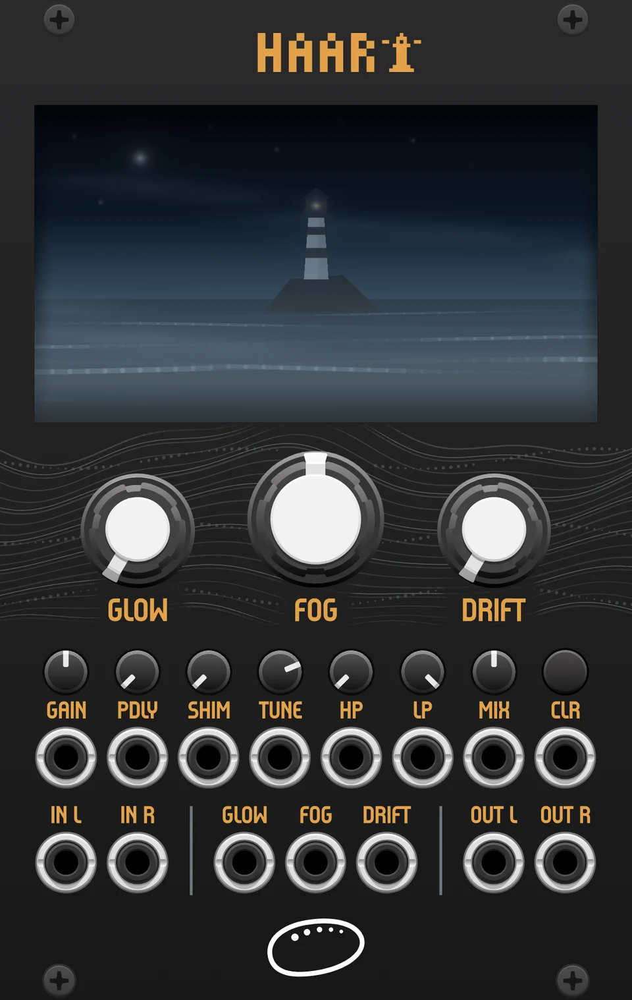
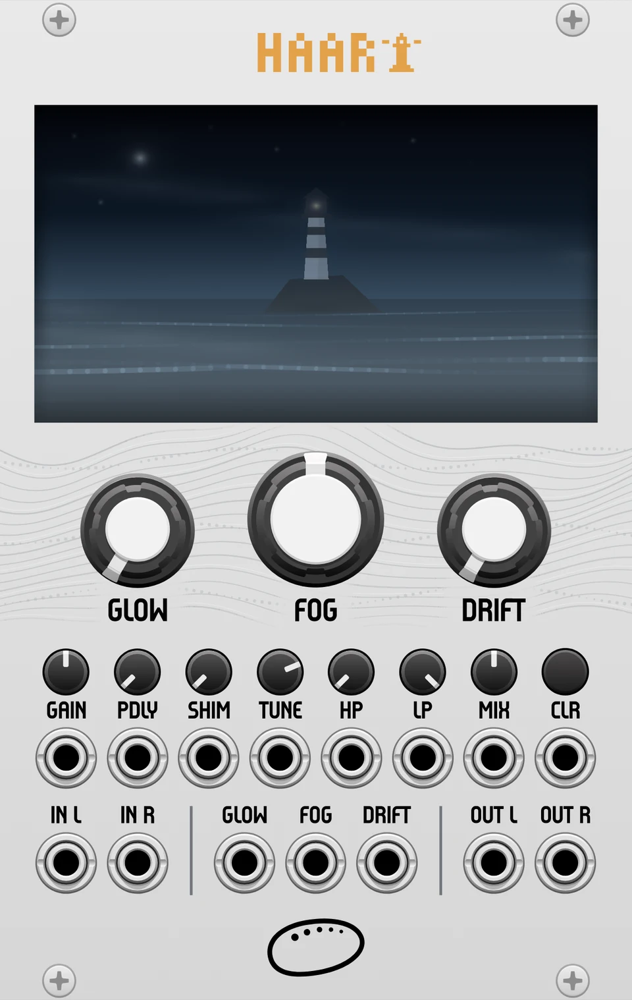

# Haar for VCV Rack: User Manual

*Ormer Modular, made in Guernsey. 16 HP.*

Haar is the sea fog that swallows the Channel Islands in an afternoon. The reverb of the same name is a lush stereo tail with that weather baked in: **highs die into the murk, lows bloom.** Three knobs do almost everything. **FOG** is how much weather, **GLOW** is the lamp warming through it, **DRIFT** is how much the world moves. A wet filter and a tunable shimmer sit underneath, plus predelay and a clear-tail button. Every knob takes CV, and the button has a trigger input.

This is the manual for the VCV Rack module. The disting NT plug-in has its own manual in [`docs/nt`](../nt/MANUAL.md).

## Contents

1. [The panel](#the-panel)
2. [The three knobs](#the-three-knobs)
3. [Filter, shimmer and levels](#filter-shimmer-and-levels)
4. [Patching and CV](#patching-and-cv)
5. [Right-click menu](#right-click-menu)
6. [Installing](#installing)
7. [Field notes](#field-notes)
8. [Troubleshooting](#troubleshooting)
9. [Specifications](#specifications)

## The panel

Haar comes in two panels, silver and black. Rack picks one from its own dark-panel setting, and you can force either from the module's right-click menu. Everything below is at its default setting.




The screen is the live scene. Fog thickens with FOG and the stars fade behind it. The lamp and its halo heat up with GLOW. DRIFT is the weather: swell rolls through the sea, the beam speeds up and hunts, and past halfway the tape brings grain, dropouts and a slow weave of the whole picture. Fair weather brings the occasional gull, and patient watchers may see the whale.

Under the screen sit the three large knobs, FOG in the middle with GLOW on its left and DRIFT on its right. Below them is a row of seven small knobs and the CLR button, each with its CV jack (or trigger input) directly beneath:

| Knob | Range | Default | CV jack beneath |
|---|---|---|---|
| GAIN | 0 to 100% | 50 | GAIN CV |
| PDLY | 0 to 500 ms | 0 | PDLY CV (10 V = 500 ms) |
| SHIM | 0 to 100% | 0 | SHIM CV |
| TUNE | -24 to +24 semitones | +12 | TUNE CV (1 V/oct) |
| HP | 25 Hz to 900 Hz | off | HP CV |
| LP | 18 kHz to 900 Hz | open | LP CV |
| MIX | 0 to 100% | 50 | MIX CV |
| CLR | button | | CLR trigger input |

The bottom row holds IN L and IN R, then the CV jacks for GLOW, FOG and DRIFT, then OUT L and OUT R.

## The three knobs

Under the knobs is a full algorithmic plate: predelay, drive, a diffusion tank with split high and low damping, a tilt EQ and a tape stage. You never meet those parameters raw. Each big knob is a **macro**, a curated path through the engine, tuned by ear against a low foghorn tone.

```
IN → PREDELAY → DRIVE → DIFFUSION TANK → TILT EQ → TAPE → HP / LP → MIX → OUT
```

### FOG: how much weather

Size, decay and diffusion ride together. The tail is fully smeared by 30%, because Haar has no interest in discrete early reflections, and noon is already a proper hall, around five to six seconds. Size glides rather than jumps, so riding FOG bends the tail's pitch tape-style. The damping asymmetry (aggressive on top, light below) is the fixed character, deepening slightly with size the way air eats treble over distance.

**The last few degrees are freeze.** Above roughly 85% the loop gain ramps to unity: the lows hold and bloom indefinitely while the high damping keeps eating the top, so a frozen chord slowly sinks into the murk instead of ringing static.

### GLOW: the lamp

Drive into the tank, with a darkening tilt EQ riding alongside so the saturation thickens instead of turning harsh. The distortion is asymmetric, which gives even harmonics and warmth rather than buzz. The loop's own saturation deepens with it, so the tail itself compresses and warms, not just the signal entering it.

### DRIFT: how much the world moves

Still water at zero, though a whisper of motion is always on because nothing analog is pitch-perfect. The lower half brings up four sine LFOs into a slow lush chorus, deepest around 45%. From there genuine random wander takes over and **the tape comes in**: wow first, then flutter and deeper saturation past 60%, and a real top-end rolloff that pulls the tail down toward 2 kHz at full. The sine chorus recedes as the weather worsens but never leaves.

> **Feel:** big DRIFT moves settle over a fraction of a second. Weather changes, it doesn't switch. As the tape engages you may hear a brief pitch swoop while the tape distance stretches in. Both are deliberate. With GLOW and DRIFT both near full the tape layer and the drive stack up and the tail turns dirty on purpose: that corner is heavy weather.

## Filter, shimmer and levels

| Knob | Range | What it does |
|---|---|---|
| HP | 25 Hz to 900 Hz | High-pass on the wet path only, shown in Hz. Thin the fog, keep the shimmer. Off at the far left, and click-free at any sweep speed. Double-click the knob to type a frequency (400, or 2.5k). |
| LP | 18 kHz to 900 Hz | Low-pass cutoff on the wet path only, shown in Hz. Right is open (the default); turning left sinks the tail down to 900 Hz. Type a frequency the same way. Independent of HP: both together leave a band of fog. |
| SHIM | 0 to 100% | Shimmer. A pitch-shifted tap of the tail feeds back into the tank, so each pass climbs (or falls). Haar's high damping eats every generation, so the voices bloom and then sink into the murk. Safe with freeze: it holds and glows rather than running away. |
| TUNE | -24 to +24 st | The shimmer interval, snapped to whole semitones, default +12 (octave up). -12 is the sleeper: the fog deepening instead of glowing. Retuning a ringing tail bends it varispeed-style. Octaves stay in key through every generation; other intervals stack as they recirculate (a fifth blooms into a spiral of fifths). That wander is the weather. |
| GAIN | 0 to 100% | Input gain into the tank. Interacts with GLOW: a hotter input drives harder. To keep the tank clean, pull GAIN and GLOW back and make the level up with Wet level in the right-click menu. Not an audio input: the audio jacks are IN L and IN R. |
| MIX | 0 to 100% | Equal-power dry/wet. 100% is the classic send-return wash. |
| PDLY | 0 to 500 ms | Predelay: space before the fog arrives. It glides when changed, bending pitch tape-style rather than clicking, so turning it live gives a swoop. |
| CLR | button | Empties the whole tail: tank, predelay, tape and shimmer. It is click-free: the wet signal fades out over a few milliseconds, the tail is wiped while it is silent, and the wet comes back. The dry signal is never touched. A trigger into the jack below does the same, which makes it a performance control. |

## Patching and CV

Haar is stereo and not polyphonic. It expects ordinary Eurorack audio, about ±5 V at the peaks, and puts out the same level. The **right input is normalled to the left**, so a mono source into IN L feeds both sides. Bypass passes left to left and right to right.

| Jack | Type | Notes |
|---|---|---|
| IN L / IN R | audio in | IN R is normalled to IN L. Haar is not polyphonic: a polyphonic cable into either input is summed to one signal. CV inputs read the first channel only. |
| OUT L / OUT R | audio out | Stereo wet and dry, mixed by MIX. |
| FOG, GLOW, DRIFT | CV in | Sums with the knob. +10 V adds the full range, -10 V takes it away, and the result is held between 0 and 100%. |
| GAIN, PDLY, SHIM, HP, MIX | CV in | The same scaling as the macros. For PDLY, +10 V is the full 500 ms. |
| LP | CV in | The same scaling, and LP is a cutoff, so positive voltage **opens** the filter. |
| TUNE | CV in, 1 V/oct | Adds 12 semitones per volt to the TUNE knob, held between -24 and +24. The knob snaps to whole semitones. The CV does not, so a quantised source lands on exact intervals and a smooth one glides through them. |
| CLR | trigger in | A rising edge (above about 2 V) empties the tail, exactly like the button. Any clock, gate or trigger will do. |

> **Nothing steps.** Every target glides inside the engine, so stepped CV, fast envelopes and sample-and-hold sources stay clean. The shimmer slides between intervals in a fraction of a second rather than jumping.

## Right-click menu

| Item | Choices | What it does |
|---|---|---|
| Wet level | 0 to +12 dB | Make-up gain on the wet path, after the reverb and before the mix. Pull GAIN and GLOW back to keep the tank clean and give it headroom, then push the tail back up here. At 0 dB (the default) Haar sounds exactly as it always did. The dry signal is not touched. Drag the slider, or click it and type a value, then press Enter. It moves in whole dB. |
| Panel | Follow Rack setting, Silver, Black | Forces the silver or the black panel for this module. The jacks and screws change with it. The choice is saved with the patch. By default the panel follows Rack's **View > Use dark panels if available**. |

## Installing

Haar is sold through the VCV Library and needs Rack 2. It is available for Mac (Apple Silicon and Intel), Windows and Linux.

1. Add Haar to your account on its VCV Library page.
2. In Rack, choose **Library > Log in**, then **Library > Update all**. Rack downloads and installs Haar.
3. Restart Rack, then add **Haar** from the module browser, under Ormer Modular.

To install a `.vcvplugin` file by hand instead: in Rack choose **Help > Open user folder**, open the `plugins-…` folder for your platform (for example `plugins-mac-arm64`, `plugins-win-x64` or `plugins-lin-x64`), put the file in it and restart Rack.

## Field notes

Starting points. Values are percentages.

**Foghorn.** The reference patch. A low, slow drone becomes a coastline.
FOG 65, GLOW 40, DRIFT 15, MIX 60. Feed it anything dark and sustained; let the asymmetric damping do the arranging.

**Held light.** Freeze as an instrument. Catch a chord, then play against the fog.
FOG 100, GLOW 25, DRIFT 10, MIX 100. Drop FOG from 100 to about 70 to let the frozen tail exhale.

**Worn tape.** The full weather: wow, flutter, grain, the top gone soft.
FOG 55, GLOW 60, DRIFT 85, MIX 70. Best on melodic loops. The wander detunes the tail against the dry.

**Undertow.** Down-shimmer: the tail keeps sinking an octave into the murk.
FOG 70, SHIM 55, TUNE -12, MIX 70. Slow melodic lines grow a seabed. Try TUNE -7 for something stranger.

**Lantern choir.** Shimmer through fog: octaves that bloom above a drone and sink back into it.
FOG 75, GLOW 30, DRIFT 10, SHIM 60, MIX 80. Push FOG to the top mid-swell and the choir hangs in the frozen fog.

**Harbour room.** Short, warm, barely moving. Haar as a mixer's space rather than an effect.
FOG 20, GLOW 30, DRIFT 0, MIX 25. Add 40 to 80 ms of PDLY to keep transients ahead of the wash.

**Shimmer arpeggio.** Let a sequence play the interval. The tail glides from harmony to harmony.
TUNE 0, SHIM 55, FOG 70, MIX 60. Patch a quantised 1 V/oct sequence into TUNE CV: 0 V is unison, 1 V an octave up.

**Breathing fog.** The tail swells on the hits and shrinks between them.
FOG 40, DRIFT 20, MIX 50. An envelope follower (0 to 5 V) from the drums into FOG CV.

**Opening and closing.** A fog that lifts and settles by itself.
FOG 65, LP 30, MIX 60. A slow LFO (0 to 5 V, about 0.1 Hz) into LP CV opens the low-pass from 30% up to about 80%, then lets it fall shut again.

## Troubleshooting

**I hear nothing.** Patch audio into IN L (IN R follows it), check that MIX isn't at zero, and make sure the module isn't bypassed.

**The panel won't change colour.** Use the module's right-click **Panel** menu. If it is set to Follow Rack setting, Rack's **View > Use dark panels if available** decides.

**The tail pitch-bends when I move FOG.** That's the size glide. The tank physically stretches, like varispeed on tape. Ride it slowly for a chorus-like bloom, or park it before a take.

**The tail swoops when I turn PDLY.** The same glide as FOG: predelay moves like a tape delay, so it slides to the new time instead of jumping. Turn it slowly, or park it before a take.

**Frozen tails eventually go dark.** By design. Freeze holds the lows at unity while high damping keeps working, so a frozen chord sinks into the murk rather than ringing static.

**Shimmer at a fifth or a third sounds like it's wandering.** Octaves stay in key through every generation, but other intervals stack as they recirculate. That drift is the weather, not a fault. Lower SHIM to keep it tidy.

**The tail vanished when I changed Rack's sample rate.** Haar rebuilds its tank for the new rate, which clears it. It rings up again as audio arrives.

## Specifications

| | | |
|---|---|---|
| Format | Rack 2, 16 HP | Stereo, not polyphonic. Silver and black panels. |
| Engine | stereo algorithmic plate | 4 input allpasses into two cross-fed branches; split high/low damping; 4 modulators (sine plus random wander per pair); tilt EQ; tape wow/flutter stage; wet HP/LP; shimmer |
| Size range | 0.25x to 2.25x | of the base plate lengths, glided |
| Predelay | 0 to 500 ms | glided, interpolated |
| Freeze | FOG above about 85% | lows sustain indefinitely; the top keeps damping |
| Audio | about ±5 V | in and out; IN R normalled to IN L |
| CV | 10 V = full range | FOG, GLOW, DRIFT, GAIN, PDLY, SHIM, HP, LP, MIX; TUNE is 1 V/oct; CLR is a trigger |
| Sample rate | 8 kHz and up | the tank is rebuilt, and clears, when Rack changes it |
| Platforms | Mac, Windows, Linux | Apple Silicon and Intel Macs |

The tank topology and base delay lengths are adapted from Mutable Instruments Rings, and the shimmer follows the Clouds pitch-shifter scheme (both MIT licence, copyright Emilie Gillet; the notice is preserved in the source). Everything else, including the runtime-sized rebuild, split damping, modulators, tape stage, the phase-aligned shimmer and the macro curves, is original. Haar is closed-source and proprietary.

*Haar for VCV Rack. Ormer Modular. Made in Guernsey.*
*Copyright 2026 Ormer Modular. All rights reserved.*
